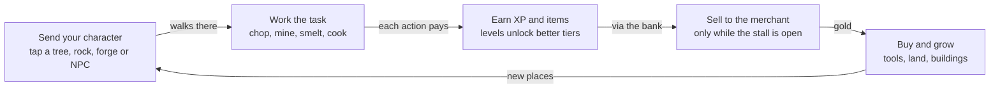
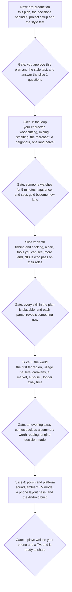

# Hearthfolk: Design & Development Plan

Version 0.8, 11 Oct 2026. This file is the source of truth for the game; every change to it or to the game is logged in [CHANGELOG.md](CHANGELOG.md).

Hearthfolk is an idle skilling game you leave running like an ant farm. You send your character to work in a living village, they level up the long OSRS way, and their earnings grow the world.

## Overview

Pre-production: the design is settled enough to build the first playable slice, and two prototypes already show its parts.

| What | Detail |
| --- | --- |
| Genre | Idle skilling with a living village |
| Players | OSRS fans without the hours for the grind, idle-game players, and anyone who wants a calm screen to leave on |
| Platforms | Phone and tablet first (Android), PC browser, TV as an ambient screen |
| Inspired by | Old School RuneScape (skills and the road to 99), Eatventure (clean look, unlock ladder), ant farms and colony sims (a society that runs itself) |
| Working title | Hearthfolk (see open questions) |

Prototypes, in `prototypes/` (double-click to open in a browser):

- `wanderskill.html`: the skilling loop, with five skills, the 1 to 99 XP curve, tools, selling and offline progress.
- `hearthfolk.html`: the living village, with villagers who have needs and routines, a chronicle, seasons, day and night, and an ambient TV mode.

## Design pillars

Every feature is checked against these five; one that adds nothing for someone watching for five minutes waits.

- **Satisfying to watch.** Motion, light and small events make the screen worth leaving on.
- **You send, they do.** Tap a place or a person; your character walks there and keeps working until you send them elsewhere.
- **The village lives on its own.** NPCs follow their routines whether or not you interact, and they also run the services you need.
- **Progress shows on the map.** XP and gold become things you can see: a better axe in hand, a new field, fog pulled back.
- **Cheap to build, cheap to extend.** Every model and picture comes from a recipe and one shared palette, so new things are cheap to add and always match.

## Core loop



Better tools and more land make every round faster and richer. You tap once and the loop runs on its own until you change the task.

| Session | What you do |
| --- | --- |
| A glance, about 10 seconds | See what changed, and send your character somewhere new |
| A sit-down, about 5 minutes | Watch the village, sell, and buy the next upgrade |
| Away for hours | Nothing: your character keeps working, and a summary greets you on return |

## Game systems

Slice 1 builds your character, two gathering skills, smithing, selling and one land purchase; the rest of this section is where the game is headed.

### Your character

- Tap a tree, rock, workstation or NPC: your character walks there and repeats the task until you send them elsewhere.
- Tapping the ground while they work speeds up the current action a little.
- The tool for the job is shown in their hand, so every upgrade shows.
- They carry what they gather in a backpack and walk full loads to the bank, which gives the screen more to watch.

### Hauling

Your character carries everything to the bank on foot at first; each later step moves more goods for less of their time.

| Step | How goods reach the bank | When (proposed) |
| --- | --- | --- |
| Backpack | Your character carries full loads on foot | Slice 1 |
| Cart | Your character pushes a cart and brings far more per trip | Slice 2 |
| Villagers | Villagers help haul your loads while you keep working | Slice 3 |
| Caravans | Caravans bring goods home from far regions | Slice 3, with the first far region |

### Skills and experience

XP follows an OSRS-shaped curve from 1 to 99: about 11.1 million XP for level 99, with level 92 at about half that. Gathering skills produce materials; processing skills turn them into something worth more.

| Skill | Kind | Where | Tiers, with the level that unlocks them |
| --- | --- | --- | --- |
| Woodcutting | Gathering | Trees | Birch 1, Oak 10, Pine 22, Maple 38, Yew 55, Ironbark 70, Moonwood 85, Elderwood 95 |
| Mining | Gathering | Rocks and ore veins | Copper 1, Tin 6, Iron 15, Coal 30, Silver 40, Gold 50, Starsteel 65, Duskite 80, Emberite 90 |
| Fishing | Gathering | Pond, river, dock | Minnow 1, Trout 12, Perch 25, Salmon 38, Pike 50, Sturgeon 65, Glowfin 80, Leviathan eel 92 |
| Smithing | Processing | Furnace (smelt ore into bars, part of Smithing); the blacksmith's anvil (forge tools, proposed) | Copper bar 1, Bronze 8, Iron 18, Steel 32, Silver 42, Gold 52, Starsteel 68, Duskite 82, Emberite 92 |
| Cooking | Processing | Campfire, later a kitchen | The fish above, at the same levels |
| Carpentry (proposed) | Processing | Sawmill: cut logs into planks, which buildings need | One plank type per log |

The exact XP table, action times, XP per action and item values are in `prototypes/wanderskill.html` (`XP_TABLE`, `ACTIONS`).

### Tools

Each skill has six tool tiers, bought from the blacksmith; each tier works faster.

| Tier | Speed | Price (gold) |
| --- | --- | --- |
| 1 | x1.00 | Starting tool |
| 2 | x1.15 | 120 |
| 3 | x1.32 | 700 |
| 4 | x1.52 | 3,500 |
| 5 | x1.75 | 18,000 |
| 6 | x2.00 | 90,000 |

Proposed: with enough Smithing, you forge your own tools at the anvil instead of buying them.

### Selling and buying

- You sell to the merchant at flat prices in slice 1: copper ore 3 gold, copper bar 10, birch log 2.
- Processing pays: a bar sells for more than its ore, so the walk to the forge is worth it.
- Gold buys tools, land, buildings (a bigger bank and forge, a dock, a sawmill) and, later, far regions.
- Later, a market and auto-sell let items sell as they reach the bank while you're away.

### NPCs

- Every NPC is a villager with needs (hunger, energy, company), five personality traits, a home and a daily routine.
- Some hold a role with a workplace: the blacksmith (forge and anvil), the merchant (stall), the cook; later a fisher and a farmer.
- A service is open only while its NPC is at work, and a closed one says why: "Bram is asleep; the forge opens at dawn."
- When a role-holder grows old and dies, an apprentice or newcomer takes over, so a service is never lost.
- NPCs react lightly to you: a greeting, thanks after a sale, a grumble if you hog the forge.
- Later, villagers can help haul your loads (see Hauling); NPC quests are not planned for now.

The villager simulation (needs, traits, routines, partners, families, roles, chronicle) is in `prototypes/hearthfolk.html` (`decide`, `runAct`, `onNewDay`).

### The world

- One continuous map: the village starts by a river, and the rest is fog.
- The village is laid out like a real one, in rings from the town square: the square itself (hearth, well, notice board, benches), then the busiest buildings facing it (city hall, bank, forge, market, inn), then workshops and storage (barn), then homes along the roads with gardens, then the resources and wilds at the edges. New buildings go in the ring that matches how busy they are.
- Land is claimed at the city hall, in parcels next to land you already have. Two ways: buy a parcel with gold (the price rises with distance from the village fire), or restore it (clear and repair it with your skills) and then claim it at the city hall.
- Each parcel also needs an XP milestone before it can be claimed, so land opens up as your skills grow (exact milestones to be set in slice 1).
- A bought parcel clears with a short animation and is seeded from the terrain: trees, ore, berry bushes, a pond, sometimes an NPC's home or a landmark.
- Far regions come later as a bigger step: a path at the map's edge opens a new area, such as a hill mine or the coast, with its own resources and NPCs.
- Seasons recolour the world, nights bring lit windows and firelight, and weather brings rain and snow.

### Idle play and the chronicle

- Your character keeps doing the last task while you're away; on return, a summary shows what they made and which levels they gained.
- Away time counts for up to 2 hours at first, raised in steps to 24 hours: 4 hours for 1,500 gold, 8 for 10,000, 16 for 60,000, 24 for 300,000.
- The chronicle records the village's life (births, deaths, buildings, seasons, your purchases) as a log you can read back.

## Art and feel

Direction (11 Oct 2026, to be confirmed by the style test): OSRS's chunky, flat-shaded low-poly models in Eatventure's bright, clean world.

- **From OSRS:** chunky low-poly models with flat, faceted shading; characters and tools you recognise by their outline; gear that changes the model, like a bronze pickaxe becoming iron.
- **From Eatventure:** bright colours, soft light and shadows, a tidy scene seen from a fixed angle above, and small characters you can read at a glance.
- Take the feel of OSRS, never its actual models, names or art.

Palette, carried over from the prototypes; every model and picture uses it:

| Use | Colours |
| --- | --- |
| Grass: spring, summer, autumn, winter | #7bb65c, #5ca04a, #b5a24a, #e2e8ea |
| Water, shore, lake highlight | #3f86c4, #b9a06c, #5a9fd8 |
| Wood, stone, stone highlight | #8a5f3a, #8a8d92, #a9adb3 |
| House wall, roof, door | #e3cfa8, #9b4a3a, #4a2f1a |
| Fire, outside to centre | #ff6a1a, #ffa41b, #ffe066 |
| Night tint, warm light | Deep blue rgb(10,16,48) at up to 62% opacity; amber rgb(255,150,60) glow around lights |
| Skill colours | Mining #d8a35a, Woodcutting #8fd36e, Fishing #7fc1ff, Smithing #c9bde6, Cooking #ff9b6a |
| Interface panel, accent, highlight | #f9f3e5 at 86% opacity, #a8641c, #e4a42a |

- **Type.** Fraunces, a serif, for the village name, banners and card titles; the device's own font for everything else; no all-caps labels.
- **Models.** Built from recipes out of simple solids with flat shading: a tree is a trunk with three faceted blobs, a house is a box with a wedge roof.
- **Light.** The sun moves across the day; at night the fire, windows and torches are real lights.
- **Camera.** Third person, OSRS-style: it circles your character, the player rotates and tilts it (drag or arrow keys) and zooms in and out. The demo also has fixed overhead angles and an over-the-shoulder Follow view for later use.
- **Motion.** Trees sway, flames flicker, water glints and people bob as they walk. Nothing flashes, and only sparks move faster than a person walks.
- **Sound.** None yet; planned for slice 4.

## Platform and technology

The game runs in the browser for now: one HTML file that opens on a phone, tablet, PC or TV with nothing to install.

- **Code.** TypeScript in modules (below), bundled by a small build step into that single HTML file. No game engine yet.
- **3D (proposed).** Three.js shows the low-poly models live, with real light for day and night.
- **Asset pipeline.** Every model and picture has a recipe in `assets-src/`, and generator scripts in `tools/` turn recipes into files in `assets/`. Models: Blender Python scripts run headless and export glTF. Pictures: ComfyUI workflows on the owner's AMD graphics card (Radeon RX 7000 or 9000 series) for style references, icons, the logo and store art. Change a recipe or the palette and regenerate; never edit generated files by hand.
- **Saves.** Progress saves in the browser, with a version number and migrations so an update never wipes a village; an export code moves a save to another device.
- **Testing.** Every module has tests. Every build runs a headless simulation of hundreds of in-game days, checking for stuck characters, broken positions and runaway shortages, then gets screenshots at phone, desktop and TV sizes.
- **Performance target.** 60 frames per second on a mid-range phone, and 2 hours of away time caught up in under 6 seconds.
- **Where it's built.** Claude Code on the owner's Windows PC, in this project folder (`A:\Hearthfolk`). Version control (Git, then a private GitHub repository) is deferred until the owner wants it.
- **AI images.** ComfyUI runs on the owner's Radeon RX 9070 XT (16 GB), installed at `A:\ComfyUI` with Stable Diffusion XL. It makes flat 2D pictures, so it is for style references, icons, the logo and store art, not for game models.
- **Live 3D (decided 11 Oct 2026).** The game shows the Blender models live in the browser with Three.js, exported as glTF with their animations. Item icons and store art are rendered from the same models.
- **Engine decision after slice 3.** Stay on the web and wrap it as an Android app, or port to Godot (free, exports to Android); the glTF models carry over directly.

### Code modules

```
src/
  core/      clock, game loop (fixed time step), save/load, event bus, seeded randomness
  data/      skills, items, prices, tools, buildings, NPC roles: tables only, no logic
  world/     map, terrain, land parcels and fog, trees and rocks
  actors/    your character, NPCs, walking
  systems/   skills and XP, backpack and bank, selling, hauling, chronicle, away time
  render/    draws the world; reads game state, never changes it
  ui/        panels, buttons, taps turned into commands
  main.ts    connects the modules
tests/       one test file per module, plus a 300-day simulation run
assets-src/  recipes for every model and picture
tools/       generators that turn recipes into assets
assets/      generated models and pictures
```

- **Drawing never changes the game.** A visual bug can't damage a save, and the art can be redone without touching the rules.
- **Modules announce events instead of reaching into each other.** When an item reaches the bank, the bank module announces it, and the chronicle, the UI and later sound react.
- **Content is data.** A new ore, tool tier or price is one row in a table, not new code.

## Product and business

Draft: the audience and positioning are set; whether and how the game earns money is still open.

- **Audience.** OSRS players who love skilling but can't spend the hours, idle-game players, and people who want a calm screen to leave on.
- **Positioning.** The skilling without the grind, and the village without the management.
- **Closest comparable.** [Melvor Idle](https://www.pcgamer.com/au/jagex-to-publish-runescape-inspired-idle-game-melvor-idle) reworks RuneScape's skills into a casual idle game, sold for a single price and published under Jagex Partners. Hearthfolk's difference is a world you watch: your character walking to the forge, villagers living around them.
- **Loop and look model.** [Eatventure](https://www.pocketgamer.biz/eatventure-vs-cat-snack-bar-an-analysis-of-both-games), Lessmore's idle restaurant game, grows from a lemonade stand to fine dining across new locations; Hearthfolk's land parcels and far regions follow the same ladder.
- **Money (proposed).** If it charges, a one-time price like Melvor Idle's, or cosmetic extras. No energy timers and no paying to skip, because waiting is the game.
- **Risks.** Being seen as a Melvor clone; idle players drifting away after the first week; the village simulation growing faster than the game around it; standing out in app stores without an ad budget.

## How we work

Work moves one small piece per round. Claude Code builds, tests and shows each piece; you play it and decide what's next.

- **You decide** what the game is, what comes next, and when something is done.
- **Claude Code** designs, writes and tests the code and the art on your PC, and keeps this plan and the changelog current.
- **Done means played.** Every task has a done-when line, and it's done once you've played it and agree.
- **Every round is logged.** A changelog entry says what changed and in which version.
- **Questions before work.** Open questions are answered before the work that depends on them, and the answers move to the decision log.
- **New ideas wait.** Ideas that come up mid-slice go to the parking lot under the backlog, not into the current slice.
- **Nothing installs without asking.** Claude Code says what it wants to install and why, and keeps everything inside this project folder.

## Roadmap



Slices are in order, not to scale; dates get set after slice 1 shows how long a slice takes.

## Before slice 1

- [x] **Project setup.** TypeScript build, test runner and the module folders (Git deferred, see decision log). Done: the game builds to one file and its 16 tests pass; the 3D demo was carried over as the starting point.
- [x] **Style test.** Done as the miner demos and the cinematic; the v2 low-poly look is the placeholder, to be refined later.
- [ ] **Slice 1 questions answered** (see open questions).

## Slice 1 backlog

Ten tasks take the village prototype to the first playable loop; tick each one once you've played it and agree it's done.

**Build order (11 Oct 2026, proposed by Claude; the owner started with step 1):** village layout, woodcutting, backpack and bank, merchant, blacksmith and smelting, a neighbour, city hall and the first parcel, away time, version 0.1. This puts the player's loop (gather, bank, sell, claim land) first and the villagers after it; where the villagers go is still the owner's call.

- [ ] **Village layout (step 1).** The village around a central hearth: bank, city hall, forge, merchant's stall and a cottage, a river to the west, forest to the north and south, copper rocks and a birch grove, unexplored land under fog to the east. Buildings say what they'll do later. Rebuilt in rings like a real village (11 Oct) after the owner's feedback. Done when you can walk the village and every slice 1 place is there.

- [ ] **Clean base.** Port the village simulation from the Hearthfolk prototype into the new modules, without priorities, blessings and petitions. Done when the village runs with day, night and the chronicle in the new look, and no player yet.
- [ ] **Your character.** Tap a tree or rock and they walk there and work until sent elsewhere. Done when tapping a tree makes them chop until you tap something else. Built 11 Oct with step 2 (game 0.0.6), awaiting the owner's play.
- [ ] **Woodcutting and mining (step 2).** Both skills on the 1 to 99 XP curve with their first tiers. Done when levels survive a reload and show in a skills panel. Built 11 Oct (game 0.0.6): six birches south of the square (level 1) and three oaks by the river (level 10), a chopping swing with an axe that replaces the pick, trees that fall and leave a stump, then grow back, and a panel with both skills.
- [ ] **Backpack and bank (step 3).** Your character fills a backpack; when it's full they walk it to the bank, empty it and go back to the same tree or rock on their own. Done when wood and ore pile up in the bank where you can count them. Built 11 Oct (game 0.0.9), awaiting the owner's play.
- [ ] **The blacksmith.** An NPC with a daily routine who keeps the forge open only while at work; you smelt copper bars there. Done when the forge is cold at night and your character waits or says why.
- [ ] **The merchant.** Buys everything at flat prices. Done when selling turns items into gold you can see.
- [ ] **A neighbour.** One ordinary villager who eats, sleeps and chats on their own. Done when they live a whole day without you.
- [ ] **First land parcel.** Buy the land east of the village; the fog clears and a tin vein appears, so bronze bars become possible. Done when gold turns into new land end to end.
- [ ] **Saving and away time.** Progress saves, and your character keeps working while the game is closed, at a fifth of the live rate for up to 2 hours. Done when closing and reopening shows a summary of what they made.
- [ ] **Test and publish.** Headless simulation, screenshots at three sizes, version 0.1 built and logged. Done when you've played it.

**Parking lot**, not slice 1: helpers who skill alongside you, NPC quests, petitions and blessings as flavour, achievements, prestige, sound, stamina for walking (11 Oct, the owner: maybe later, now that walking is faster), a watch showing the time of day, when it gets dark and where north is (11 Oct; possibly an item bought from the merchant, or a sundial on the square).

## Decision log

Twenty-six decisions so far, newest first; each answered open question is added here with its date.

| Date | Decision |
| --- | --- |
| 11 Oct 2026 | How new land is obtained is open again: land is there to explore, and getting it may take a task, a price, or both. The earlier decisions (claimed at the city hall, gold plus an XP milestone) stand as the working plan until this is settled; not needed before step 7. |
| 11 Oct 2026 | Progress runs at the full rate (1x) while the game is open, even in a background tab or with the screen off, and at a fifth of it (0.2x) while the game is closed, for at most 2 hours; after that the character stops until you come back. The game cannot tell a game you closed from one the phone closed in the background, so both count as closed. The 2 hours is easy to change later. |
| 11 Oct 2026 | The backpack's size doesn't matter for now (easy to expand later). When it's full, the character walks it to the bank, empties it and goes back to work on their own. |
| 11 Oct 2026 | Little downtime while gathering: when a tree falls or a rock runs out, the character moves on to the nearest free one of the same kind, as long as that is quicker than waiting for it to grow back. |
| 11 Oct 2026 | Git and GitHub after all, replacing the earlier "no Git" decision: a private repository on the owner's GitHub account, pushed after every round, so the work is safe off the PC. |
| 11 Oct 2026 | The village is laid out like a real village: the town square at the centre, the busiest buildings round it, then workshops, then homes, then the edges. |
| 11 Oct 2026 | The game model can still change: it doesn't have to be an idle game. The owner's view is that an idle core is the best way to make an OSRS-style game streamlined and modern for how people use phone games, so that stays the direction; the code keeps room for more hands-on play. |
| 11 Oct 2026 | Land is claimed at the city hall: bought with gold, or restored first and then claimed. |
| 11 Oct 2026 | The default camera is third person and rotatable, OSRS-style. |
| 11 Oct 2026 | The game is live 3D (Three.js and glTF models), not pre-rendered sprites. |
| 11 Oct 2026 | The v2 low-poly miner look is placeholder art to build on; the final look is settled towards the end. |
| 11 Oct 2026 | No Git or GitHub for now; the project lives in `A:\Hearthfolk` on the owner's PC. Revisit once losing the work would hurt. |
| 11 Oct 2026 | Land is bought with gold, and each parcel also needs an XP milestone before it opens. |
| 11 Oct 2026 | Smelting is part of Smithing, not its own skill. |
| 11 Oct 2026 | The graphics card is a Radeon RX 9070 XT with 16 GB; ComfyUI runs on it. Pixel-art test icons were made for Wanderskill and don't fit Hearthfolk's look; game art comes from 3D models. |
| 11 Oct 2026 | Claude Code on your PC builds everything (code, art, this plan) in a local project folder; this file replaces the Claude doc as the plan. |
| 11 Oct 2026 | The art moves toward OSRS-style low-poly models with Eatventure's bright, clean look; a style test confirms it before slice 1. |
| 11 Oct 2026 | The code is split into modules that announce events to each other, each with its own tests. |
| 11 Oct 2026 | Your character carries everything to the bank. Hauling grows in this order: a backpack, then a cart, then villagers who help, then caravans. |
| 10 Oct 2026 | Development continues in the chat with Claude, guided by this plan and its changelog (replaced on 11 Oct by Claude Code). |
| 10 Oct 2026 | The world grows two ways: land bought around the village, and far regions later as a bigger step. |
| 10 Oct 2026 | NPCs run the services and live their own routines; for now they aren't hired and don't give quests. |
| 10 Oct 2026 | You send the character: tap a place or an NPC, and they work until sent elsewhere. |
| 10 Oct 2026 | One game combines the skiller's loop with the village's living NPCs: work, earn XP, sell, buy, grow the world. |
| 8 Oct 2026 | Build in small slices with your feedback, not whole games in one go. |
| 8 Oct 2026 | The look stays simple and easy to replicate: flat shapes, easy on the eyes, as clear as Eatventure (the flat shapes were replaced on 11 Oct by the low-poly direction; clear, easy-to-replicate art still stands). |

## Open questions

Nine questions for you, in the order they're needed; the first is needed during slice 1.

| Question | Options | Needed by |
| --- | --- | --- |
| How is new land obtained? | Pay gold at the city hall; do a task to restore it; reach a level (total, or the skill the land serves); a mix | Slice 1, step 7 |
| Is "cut wood" a Carpentry skill, with planks used for building? | Yes; fold it into Woodcutting; not now | Slice 2 |
| Can you forge your own tools? | Buy only; buy or forge | Slice 2 |
| Do NPCs age and die, with someone taking over their role? | Yes; no, they stay | Slice 2 |
| Do merchant prices move? | Flat; shifting with supply | Slice 2 |
| Do far regions need levels as well as gold? | Gold only; gold and levels | Slice 3 |
| Which engine after slice 3? | Web, wrapped as an Android app; Godot; Unity | Slice 4 |
| Does the game charge, and how? | Free; one-time price; cosmetic extras | Slice 4 |
| What's the game called? | Hearthfolk; Wanderskill; a new name | Before sharing |

## Sources

- [Jagex to publish RuneScape-inspired idle game Melvor Idle](https://www.pcgamer.com/au/jagex-to-publish-runescape-inspired-idle-game-melvor-idle), PC Gamer, 24 Oct 2021
- [Eatventure vs Cat Snack Bar: an analysis of both games](https://www.pocketgamer.biz/eatventure-vs-cat-snack-bar-an-analysis-of-both-games), PocketGamer.biz, undated (cites figures to about August 2023)
- [AMD x ComfyUI: Advancing Professional Quality Generative AI on AI PCs](https://www.amd.com/en/blogs/2026/amd-comfyui-advancing-professional-quality-generative-ai-ryzen-radeon.html), AMD, 5 Jan 2026
- [Amuse](https://www.amd.com/en/ecosystem/isv/consumer-partners/amuse.html), AMD consumer partners page
- [How to set up ComfyUI on an AMD RDNA 4 GPU using ROCm on Windows](https://wccftech.com/how-to-setup-comfyui-ai-image-generation-on-amd-rdna-4-gpu-rocm-7-1-1-windows/amp/), Wccftech, 15 Dec 2025
